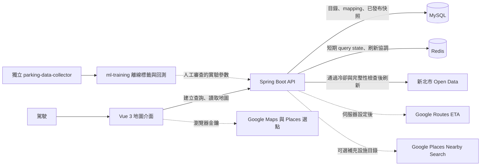

# Taiwan Parking Forecast

## 目前以新北市新莊區作為試點

協助駕駛查詢目的地附近的路邊格位與路外停車場，並分開呈現官方目前觀測、資料時效和抵達時預測。產品用來輔助停車決策，不保留車位，也不保證抵達時一定有位。

> 這是以一人 Scrum 方式開發的個人全端專案。產品目標是逐步建立全臺有資料停車場的查詢基礎；TDX 尚未接入主系統，目前完成的是新北市新莊區即時來源試點，不代表完整新莊覆蓋。

## 目前進度

進度以 [`docs/current-state.md`](docs/current-state.md) 為準。本次 repo 複核日期為 2026-11-03；最近一筆產品與架構實作紀錄為 2026-10-29，目錄數據依 2026-10-27 的伺服器同步紀錄。

- **線上資料試點**：主系統即時介接新北市 Open Data。已審查並同步的目錄包含 1,880 筆路邊格位、138 個路外場站；這是可用的已審查子集，不是新莊完整目錄。現行服務範圍是新莊 MVP 矩形區域，不等於精確行政區邊界。
- **主系統基線**：Vue 地圖查詢、Spring Boot API、MySQL／Redis、Google Maps／Places 載入路徑、Google Routes ETA 降級，以及受控官方來源刷新已實作。
- **部署狀態**：部署文件記錄使用者回報已部署至 Hetzner。這是部署紀錄，不代表本次已重新驗證遠端健康狀態、HTTPS 或完整瀏覽器查詢流程。
- **模型狀態**：後端含路外 30／60 分鐘校準持續性實驗產物，只有符合資料與 ETA 條件時才回傳 `EXPERIMENTAL`。路邊目前沒有線上預測模型；S3-020 正式模型准入尚未通過。
- **下一步**：持續治理完整 catalog／mapping 與覆蓋界線、量測官方來源端到端刷新、盤點 collector 訓練資料品質，並完成 ETA-aware 標籤、回測與正式模型准入證據。

## 使用者查詢流程

1. 使用 Google Places 選擇目的地；目前畫面提供「立即」出發，起點可用 Places 或裝置目前位置設定。
2. 後端以目的地為中心，從本機已審查目錄查詢 500 公尺內的路邊格位與路外場站，並讀取各自最新的 `PUBLISHED` 官方快照。
3. 有起點且 Routes 伺服器金鑰與外部呼叫設定有效時，後端計算到目的地的 ETA。沒有起點或 ETA 不可用時，附近停車查詢仍可使用，但不顯示虛構抵達時間。
4. 地圖、篩選、清單和詳情呈現位置、類型、官方觀測、品質、資料時間與適用性。Google Places 可補充停車設施地點，但不提供官方即時空位，會以未知狀態區別。
5. 使用者手動更新，或頁面恢復顯示且資料需要更新時，前端才發起受控刷新。地圖平移、縮放和 viewport 分頁是唯讀操作，不會觸發政府來源刷新或 Routes 計算。

## 系統結構

`parking-data-collector` 是獨立的離線訓練資料收集器，不提供主系統查詢、即時快照或 API；使用者查詢不會觸發訓練。模型實驗產物不會由 collector 自動部署。

## 技術架構

| 層次 | 技術 |
| --- | --- |
| 前端 | Vue 3、Vite、Google Maps JavaScript API、Places Autocomplete |
| API | Java 21、Spring Boot 4.1.1、Spring MVC、Spring Data JPA、Flyway |
| 持久資料 | MySQL 8.4；停車目錄、來源 ID mapping、擷取紀錄、快照與觀測歷史 |
| 短期狀態 | Redis 8；query state、防重送識別碼與來源刷新短鎖 |
| 外部來源 | 新北市 Open Data；Google Routes ETA 與 Google Places 設施地點為可設定整合 |
| 執行與建置 | Docker Compose、Nginx、Node.js 24（前端建置）；離線訓練使用 Python 3 |

## 工程設計重點

- **完整快照才切換**：NTPC 來源可能限制實際分頁大小，因此只有讀到空頁才確認遍歷完成。達到頁數上限仍未讀到結尾時拒絕發布；查詢只讀已發布快照，失敗時保留上一版。
- **來源 ID 必須核對**：資料只透過 `VERIFIED` mapping 關聯內部停車位置；一般汽車資格未確認、狀態碼未知或來源值異常時，不轉成「有位」或 0 位。
- **MySQL 保存事實，Redis 保存短期狀態**：MySQL 保存目錄、刷新冷卻、快照和歷史觀測；Redis 保存短效查詢狀態並協調刷新。來源失敗不會把候選資料覆蓋成正式快照。
- **刷新受控且可觀測**：後端依來源冷卻、HTTP 請求與品質檢查決定能否刷新；刷新紀錄保留頁數、請求數、資料量與品質摘要。前端五分鐘展示時效是保守顯示門檻，不是資料來源 SLA。
- **外部地點資料不冒充官方觀測**：Google Places 補充的設施地點不帶即時空位；官方資料時間、系統取得時間、未知和過期狀態分開處理。
- **查詢契約有明確邊界**：`POST /api/v1/parking-queries` 建立查詢；`GET /{queryId}`、`GET /map-data`、`GET /map-data/viewport` 讀取狀態或地圖資料；`POST /{queryId}/refresh` 才執行受控刷新。Redis query state 預設保留 30 分鐘。

## 離線模型實驗與限制

首輪模型比較使用 2026-09-24 至 2026-10-24 的 31 天 collector 樣本，按日期先後切成 train／validation／test（25／3／3 天）。未知值、跨切分抵達標籤與不合格觀測會被排除或記錄原因；選模使用 validation，test 日期已分析過，不是新的 holdout。

目前接入主系統的只有路外校準持續性實驗參數。已分析的三日 test 中，30／60 分鐘 Brier score 為 0.0115／0.0163，固定 persistence 對照為 0.0130／0.0178。分數改善是實驗證據，不足以證明新日期或其他地區上的正式預測能力。

API 只有在路外汽車資格已確認、來源快照可用且系統取得時間不超過 15 分鐘、目前位數與狀態一致，以及 ETA 落在快照後約 30 或 60 分鐘（±15 分鐘）時，才可能回傳 `EXPERIMENTAL` 機率。產物仍標示 `EXPERIMENT_ONLY`／`publishToOnlineSystem=false`，不代表 S3-020 通過。路邊區域機率仍回 `INSUFFICIENT_DATA`；固定 30／60 分鐘實驗也不等於支援任意 ETA 的正式模型。

- [最新進度與工程紀錄](docs/current-state.md)
- [產品需求與驗收](docs/requirements.md)｜[產品定位](docs/PRODUCT.md)
- [決策紀錄](docs/decisions.md)｜[待確認問題](docs/open-questions.md)
- [Sprint 3 預測進入條件](docs/sprint-3-entry-criteria.md)
- [部署與維運](docs/docker-deployment.md)
- [模型訓練架構](docs/model-training-architecture.md)｜[離線 workspace](ml-training/README.md)
- [原 README 封存版本](docs/README-archive-2026-11-03.md)
