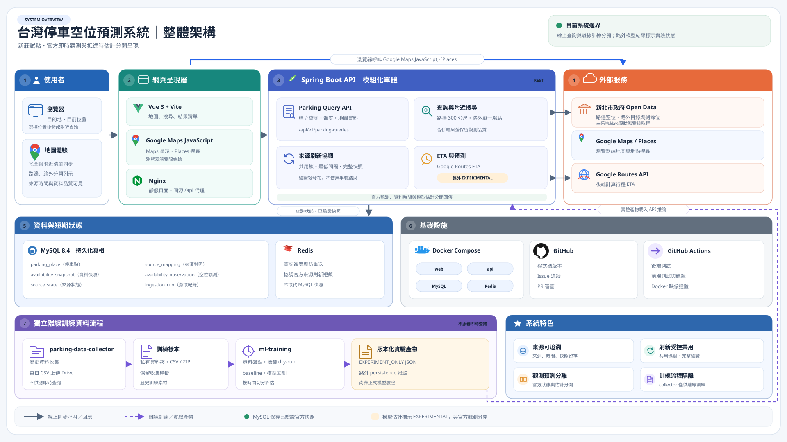

# 整體系統架構

[開啟含技術棧標示的 HTML 架構概覽](system-architecture.html)

[另開 SVG 全圖檢視](system-architecture.svg)

HTML 概覽依參考圖的閱讀方向重新編排：上方用五步呈現查詢流程，中間以六個系統層整理線上元件，底部另列五階段的離線訓練流程；下方第二張圖再展開部署與 CI。主圖使用 16:9 畫布、專案暖米白／深藍灰／綠色配色，以及前端相同的字型。Vue、Vite、Spring Boot、MySQL 與 Redis 標誌皆內嵌，不需載入外部圖片。

圖面依目前實作描述資料流：主系統 API 直接讀 MySQL 停車目錄與已發布快照；Redis 保存短期查詢狀態、防重送識別碼及來源刷新短鎖，不是附近結果的通用快取代理。`parking-data-collector` 與 `ml-training` 在離線流程運作，不處理使用者查詢、不讀線上快照。路外小型實驗參數檔目前置於 API classpath，符合條件時以 `EXPERIMENTAL` 呈現；這不是正式模型准入，也不代表訓練程式會自動發布產物。路邊目前沒有線上預測模型。

HTML 版保留兩張圖：主圖聚焦使用者查詢與離線模型實驗；基礎設施圖說明 Hetzner 主機、Docker Compose 網路、Web／API／MySQL／Redis、GitHub repository 與 Actions。圖內說明採大三學生容易理解的文字，技術名稱與版本保留。`node-name`、`node-name-small` 及主要技術元件配有內嵌 SVG 圖示，純裝飾圖示對輔助科技隱藏；全頁字型採前端 `frontend/src/style.css` 的 `Inter, "Noto Sans TC", "PingFang TC", system-ui, sans-serif`。Hetzner 部署依 `docs/docker-deployment.md` 記錄；HTTPS 代理軟體未確認，所以圖中標為依主機設定。

技術棧依 repo 設定核對：Vue 3.5.43、Vite 8.3.1、Node.js 24（建置）、Nginx 1.29、Java 21、Spring Boot 4.1.1、Maven Wrapper 3.9.16、MySQL 8.4、Redis 8、Spring Data JPA／Redis 與 Flyway。`ml-training` 只標示 Python 3；repo 沒有鎖定 Python 小版本。

Docker Compose 的 Web 只綁定主機 loopback `127.0.0.1:8080`；API、MySQL、Redis 僅在 Compose 網路內使用。MySQL 透過 `mysql-data` named volume 保留資料。GitHub Actions 跑後端／前端測試和 Docker image build，不自動推送映像或部署。Redis 是 API 直接使用的短期狀態服務，保存查詢狀態、防重送識別碼並協調來源刷新短鎖；API 讀取停車目錄及已發布空位資料時直接連 MySQL。一般附近結果快取仍屬待量測的設計選項，並非目前已實作的 Redis 路徑。六張 MySQL 表、API 端點與操作命令等細節仍以原 SVG 和其他工程文件為準。
